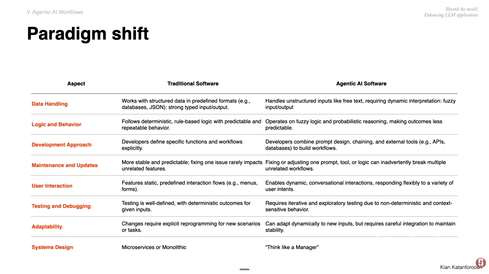
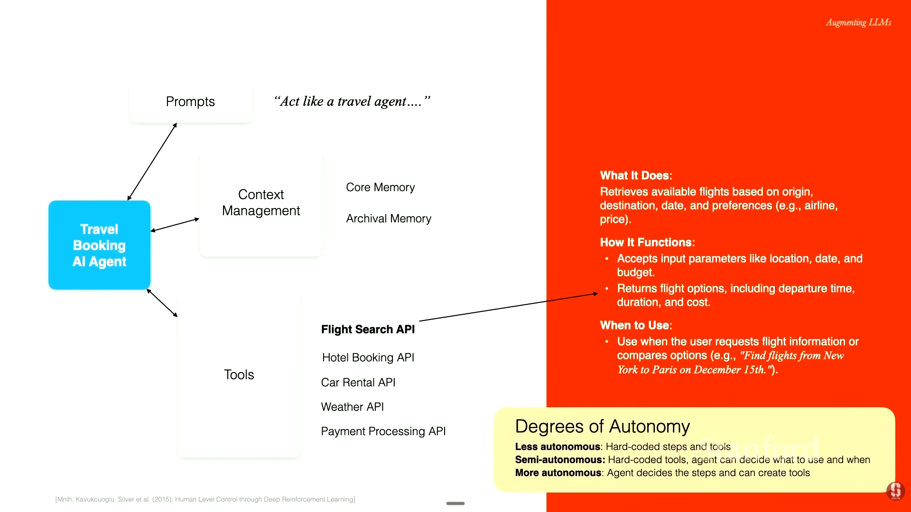
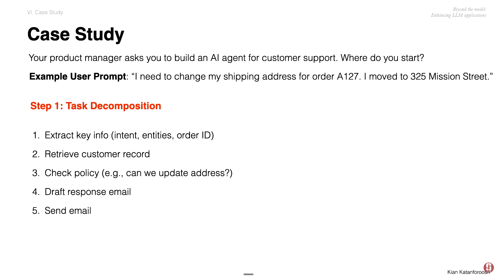
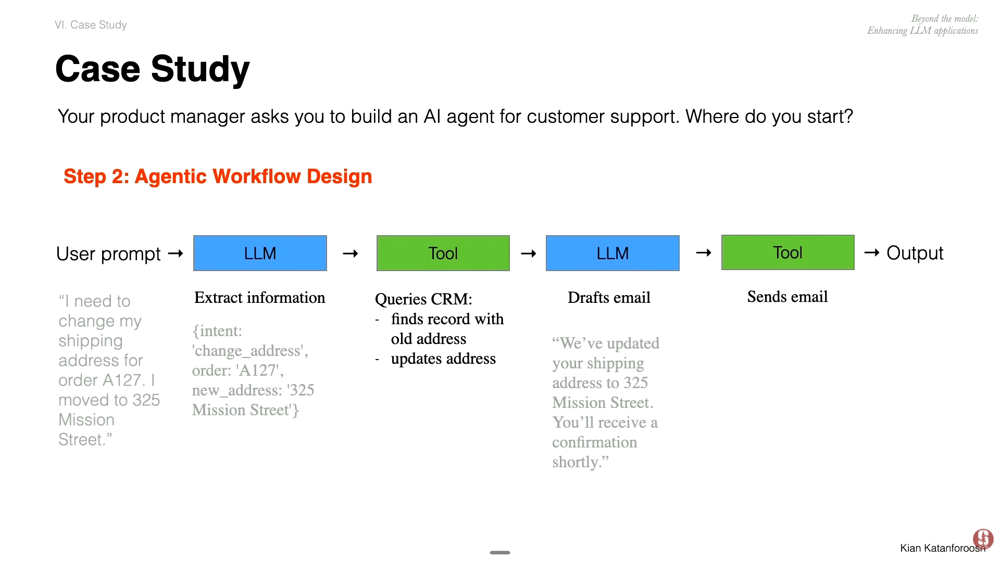
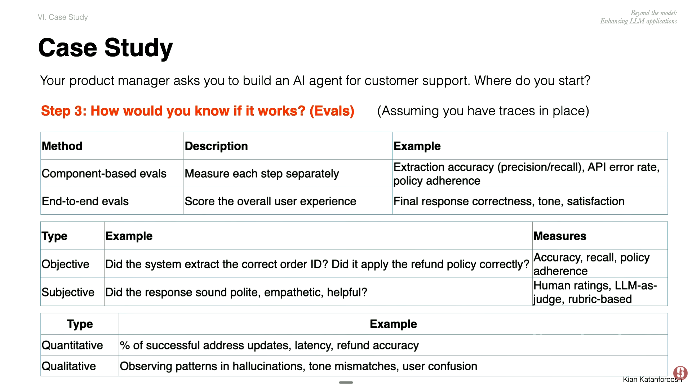
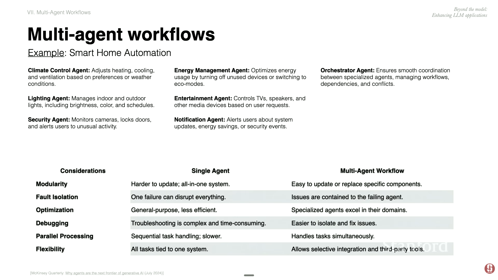
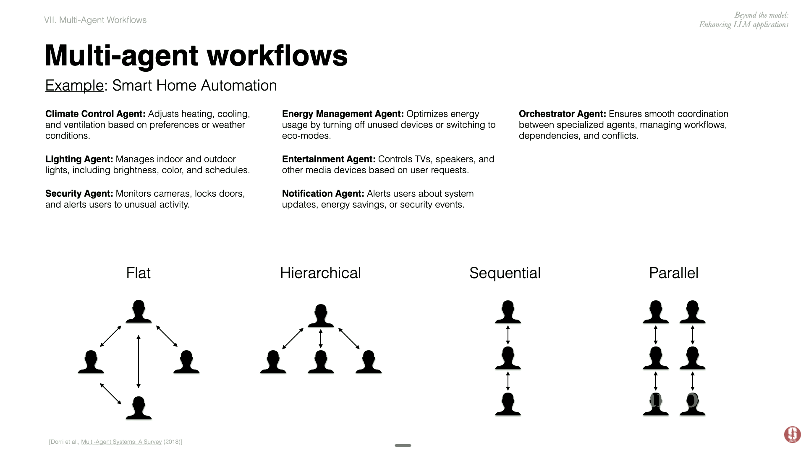

# References:
- [Stanford CS230 Deepleaning |Autumn 2025|Lecture 8: Agents, Prompts, and RAG](https://www.youtube.com/watch?v=k1njvbBmfsw&t=3626s)

# Agentic Workflow

## Paradigm Shift

## Why agents are the next frontier of generative AI

[Mikinsey| why agents are the next frontier of generative AI|July 2024](https://www.mckinsey.com/capabilities/tech-and-ai/our-insights/why-agents-are-the-next-frontier-of-generative-ai#/)

### Credit-risk memos

## Travel Booking AI Agent

[Mnih | Human-level control through deep reinforcement
learning| 2014](https://web.stanford.edu/class/psych209/Readings/MnihEtAlHassibis15NatureControlDeepRL.pdf)

## Eval Agent Workflow

- trace of agent
- component based eval
- end to end eval
- llm as juge

## Case Study

1. Decompose tasks

2. Agentic Workflow design

3. Eval

# Multi-agent workflows

## Pros:
- parallism

## Multi-agent Design

